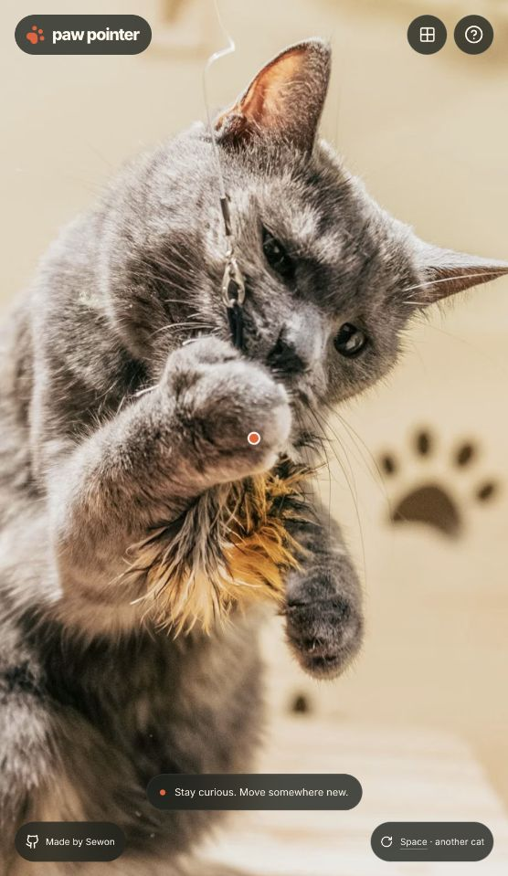

# Paw Pointer 성능 개선기

200장으로 확장한 뒤, 사진 수보다 요청을 시작하는 순서가 체감 속도를 제한했다. 첫 접속과 터치에도 1.2초 타이머를 적용했고, 타이머가 끝나야 다운로드를 시작했다. 사진 선택은 200개 좌표를 비교하는 작은 계산이므로 공간 인덱스를 추가하기보다 이 직렬 대기를 없앴다.

## 측정 결과

아래는 동일한 200장 이전 빌드와 개선 빌드를 번갈아 실행한 중앙값이다. 각 환경·버전마다 독립적인 새 브라우저 컨텍스트 5회, 첫 사진 5개 표본, 전환은 실행당 3개 위치로 총 15개 표본이다. 원시 표본은 [paired.json](paired.json)에 있다. 표의 감소율이 음수이면 느려진 것이다.

| 지표 | 이전 | 개선 | 감소율 |
|---|---:|---:|---:|
| 데스크톱 · 첫 사진 준비 | 1333 ms | 71 ms | 94.7% |
| 데스크톱 · 위치 변경 후 준비 | 1241 ms | 1229 ms | 1.0% |
| 데스크톱 · 컬렉션 첫 카드 DOM 표시 | 87 ms | 829 ms | -852.9% |
| 모바일 · 첫 사진 준비 | 3746 ms | 1628 ms | 56.5% |
| 모바일 · 위치 변경 후 준비 | 1977 ms | 595 ms | 69.9% |
| 모바일 · 컬렉션 첫 카드 DOM 표시 | 244 ms | 439 ms | -79.9% |

- 데스크톱: 1440×900, DPR 1, localhost, 네트워크·CPU 제한 없음.
- 모바일 에뮬레이션: 390×844, DPR 2, 터치, CPU 4배 slowdown, 다운로드 200,000 bytes/s(1.6Mbps), 업로드 93,750 bytes/s, 지연 150ms.
- Chrome 버전: 155.0.8059.86. HTTP 캐시는 비활성화했다. 앱의 디코드 캐시는 실행 중 유지된다.
- 이전은 4175의 동결 빌드, 개선은 4174의 production preview. 실행 순서를 번갈아 배치해 순서 편향을 줄였다. 로컬 측정이므로 실제 CDN, 기기, Safari 결과로 일반화하지 않는다.
- 첫 사진은 navigation부터 이미지 decode 후 `data-phase=ready`까지, 전환은 입력부터 다른 사진의 ready까지 측정한다. 입장 애니메이션 완료 시각이나 LCP가 아니다. 첫 사진 타이밍에는 Playwright 관찰 비용도 포함된다.
- 전환 위치는 (80,180), (300,600), (180,400). 양쪽 같은 화면·좌표·카탈로그를 사용하며 결과 사진 ID도 원시 데이터에 남겼다.
- 컬렉션은 첫 카드 DOM 표시까지다. 썸네일 전체 다운로드 완료를 뜻하지 않는다. 코드 지연 로딩으로 첫 열기 비용이 늘 수 있다.

## 바꾼 흐름

```text
이전 첫 접속/탭: JS → 1200ms 대기 → WebP 요청 → decode → 표시
개선 첫 접속: HTML AVIF preload ─┐
                 JS 실행 ──────┴→ decode → 표시
개선 탭: 요청 → decode → 표시
이전 마우스: 정지 → 1200ms → 요청 → decode → 표시
개선 마우스: 정지 → 150ms → 선택 사진 요청/decode
                       1200ms 시점 → 준비됐으면 즉시 표시
```

첫 접속과 터치에서는 의도적인 1.2초 대기를 제거했다. 따라서 이 부분의 개선률 전체를 압축이나 CPU 최적화의 효과라고 주장할 수 없다. 마우스는 원래 연출인 1.2초 정지 시간을 유지하면서 네트워크 대기를 겹쳤다. 커서가 바뀌면 AbortController와 이미지 src 제거로 이전 로드를 중단하고, 세대 번호 검사로 늦은 응답의 덮어쓰기도 막는다. 브라우저가 이미 받은 바이트까지 되돌릴 수는 없다.

기존의 엉뚱한 다음 후보 speculative preload를 없애고, 실제 목표 위치에 선택될 사진만 준비한다. 디코딩한 Image 참조는 LRU 6개로 제한한다. 이는 애플리케이션이 보유한 참조 한도이며 브라우저 전체 HTTP·GPU 메모리가 6장으로 제한된다는 의미는 아니다.

## 이미지와 초기 코드

- 전체 200장 full WebP 합: **41,019,376 bytes**.
- 각 사진에서 더 작은 AVIF/WebP를 선택한 합: **29,718,977 bytes**, **27.55% 감소**. 전체 라이브러리를 접속 시 내려받는 것은 아니다.
- 첫 중앙 사진: WebP **237,212 → AVIF 146,995 bytes**, **38.03% 감소**.
- 픽셀 크기와 발 좌표는 모두 유지했다. Pillow AVIF quality 65, speed 6으로 기존 WebP에서 재인코딩했다. 무손실 변환은 아니다. 대표 3장을 나란히 비교했을 때 눈에 띄는 차이는 없었지만 200장 전체 화질의 수치적 동등성을 검증한 것은 아니다.
- AVIF decode 지원 확인 후 사용하며, 실패 시 같은 사진의 WebP로 fallback한다. 최초 사진 preload는 빌드 시 중앙 좌표 선택 결과에서 생성한다.
- 초기 JS gzip: **93,004 → 85,434 bytes (8.14% 감소)**. 원시 JS는 **330,726 → 285,479 bytes**. 실제 서버의 Content-Encoding 설정에 따라 전송량은 다르며, 벤치마크 resource 기록을 별도로 보관했다.
- `gallery.json`에는 실행에 필요한 좌표·크기·경로만 둔다. 전체 사진 메타데이터와 Collection/About은 lazy chunk로 분리했다. Collection chunk gzip 18,341 bytes는 처음 열 때 부담한다. 카드에는 content-visibility를 적용했다.
- WebP fallback도 보존하므로 배포 폴더는 **43,643,104 → 73,469,408 bytes**로 커졌다. 저장 공간을 더 쓰고 방문자 전송량을 줄이는 선택이다.

## 검증과 한계

단위 테스트 **6개**, 브라우저 테스트 **13개** 통과. 빌드와 diff whitespace 검사도 통과했다. 좌표 정렬, 모바일 탭·회전·넘침, 키보드, 느린 응답 경합, 실패 재시도, AVIF 실패 시 WebP fallback, 마우스 1.2초 유지 및 사전 요청, 초기 Collection chunk 미요청을 확인했다. 모바일은 Chromium 에뮬레이션이며 실물 기기 검증은 아니다.

첫 사진·탭을 빠르게 만들되 기존의 사진 선택과 발끝 정렬 계산은 유지했다. 네트워크가 느리면 마우스 1.2초가 끝나도 준비 중 상태가 남을 수 있다. 5회 표본은 이 환경의 비교 근거이며 p95 SLO나 전체 사용자 성능을 보장하는 근거가 아니다. 이번 변경들을 묶어서 비교했으므로 각 최적화의 독립적인 인과 기여도는 별도 ablation 실험이 필요하다.

## 재현과 증거

```sh
npm run build
# 이전 빌드를 별도 폴더에 보관한 상태에서 두 preview를 실행
npm run preview -- --outDir .work/perf-v2/before-dist --port 4175 --strictPort
npm run preview -- --port 4174 --strictPort
node scripts/benchmark-paired.mjs
npm test
PLAYWRIGHT_CHROME_EXECUTABLE="/Applications/Google Chrome.app/Contents/MacOS/Google Chrome" npm run test:e2e
```

이전 빌드는 로컬 `.work/perf-v2/before-dist`에 보존했다. 현재 소스만 새로 받으면 이전 빌드가 자동 복원되는 것은 아니다. [빌드 파일 해시와 크기](builds.json), [이미지별 인코딩 결과](encodings.json), [측정 스크립트](benchmark-paired.mjs), [대표 화질 비교](quality.jpg)를 함께 보관한다.

## 요청 시작 시점으로 확인한 병목

모바일 첫 실행의 Resource Timing에서 중앙 사진 요청 시작은 이전 **2,141ms**, 개선 **170ms**였다. 개선 후 HTML preload가 JS 요청과 같은 시점에 시작했다. 사진 전송 크기(헤더 포함)는 **237,512 → 147,295 bytes**였다. 첫 사진의 요청 지연 제거와 파일 축소가 함께 작동한 증거이며, 이 한 표본의 시각은 중앙값과 구분한다.

컬렉션 표시 시간에는 Playwright의 클릭 actionability 검사와 locator 대기도 포함된다. 따라서 관측한 829ms를 순수 React 렌더링 시간으로 해석하지 않는다. 첫 열기의 네트워크·Suspense 비용을 후속 최적화 대상으로 남긴다.


